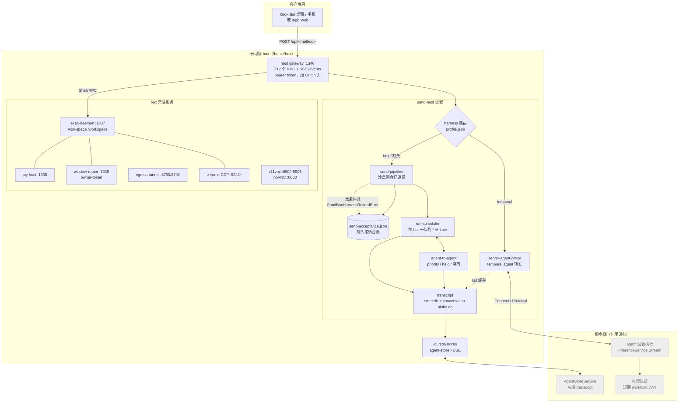
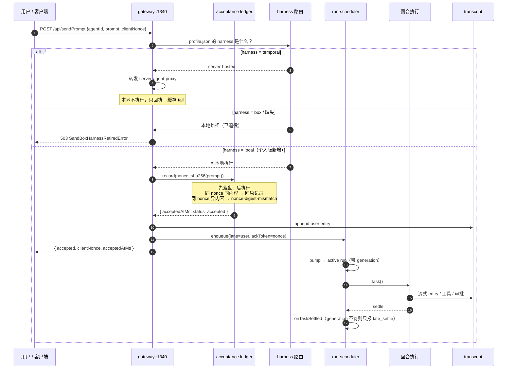
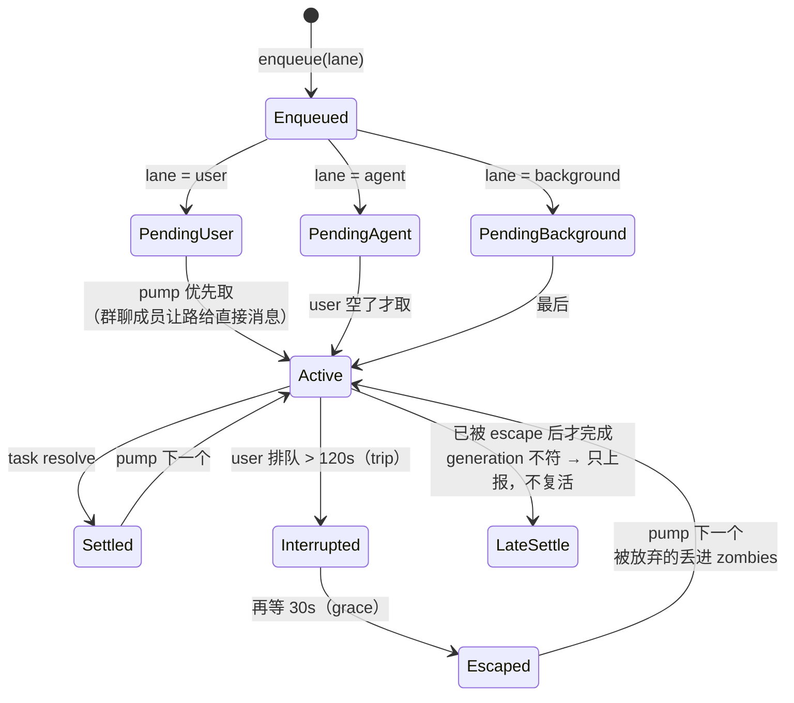
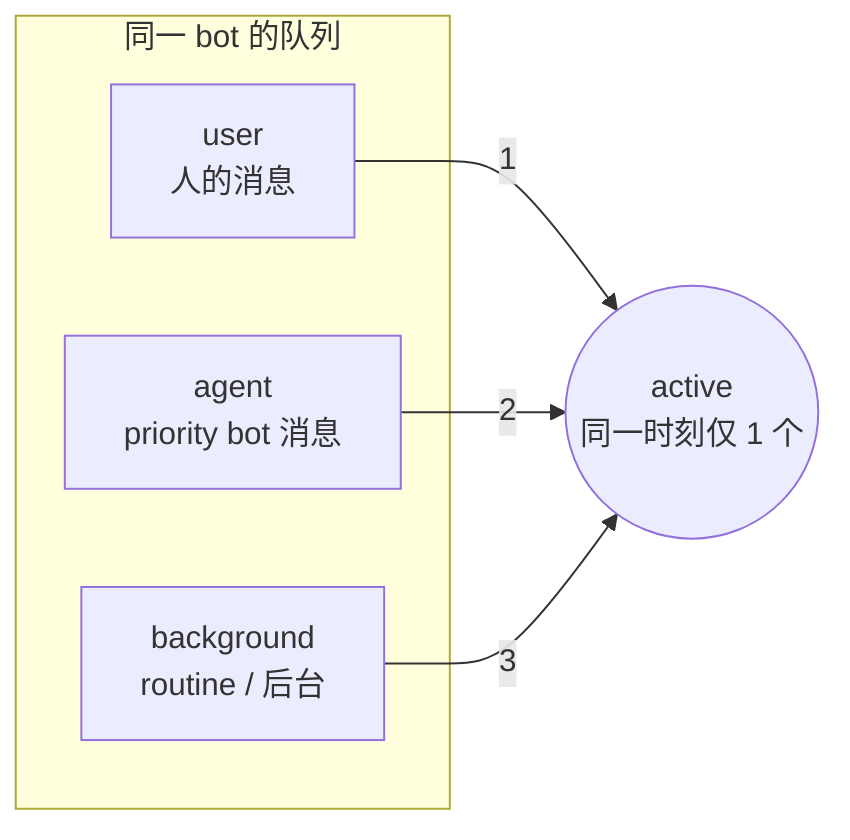
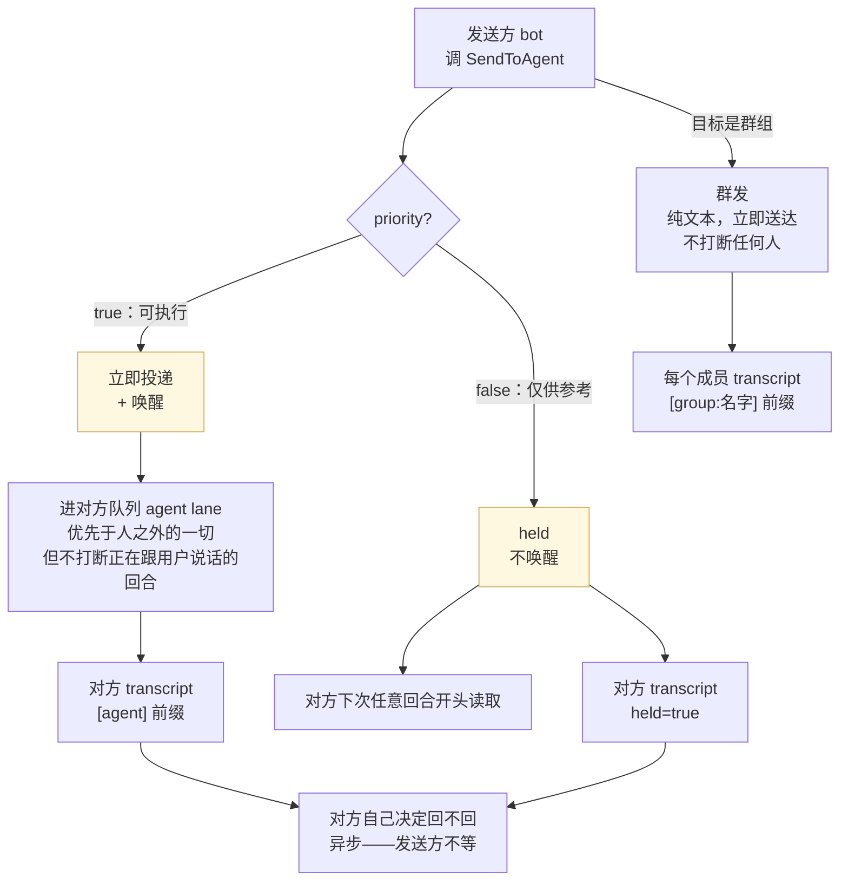
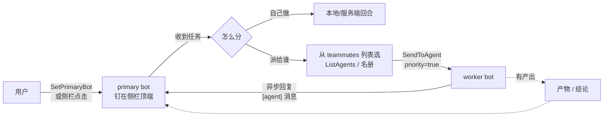
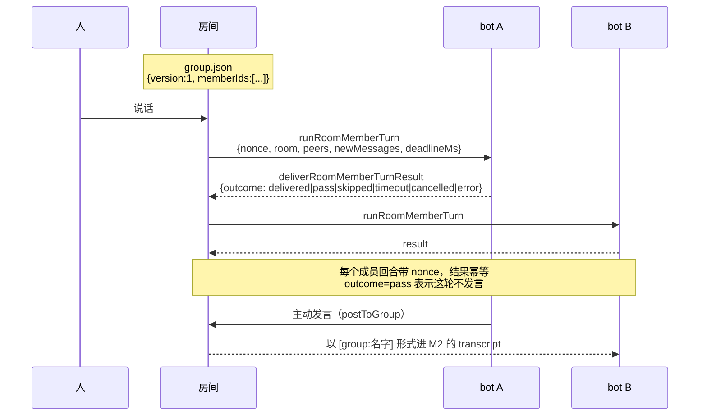
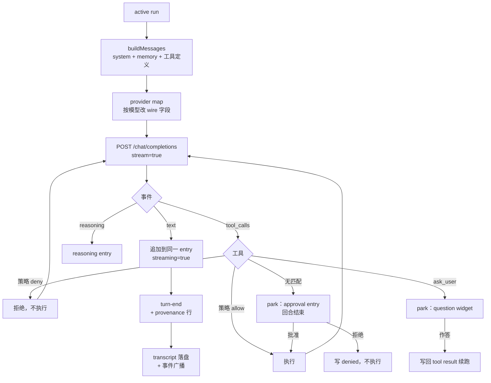
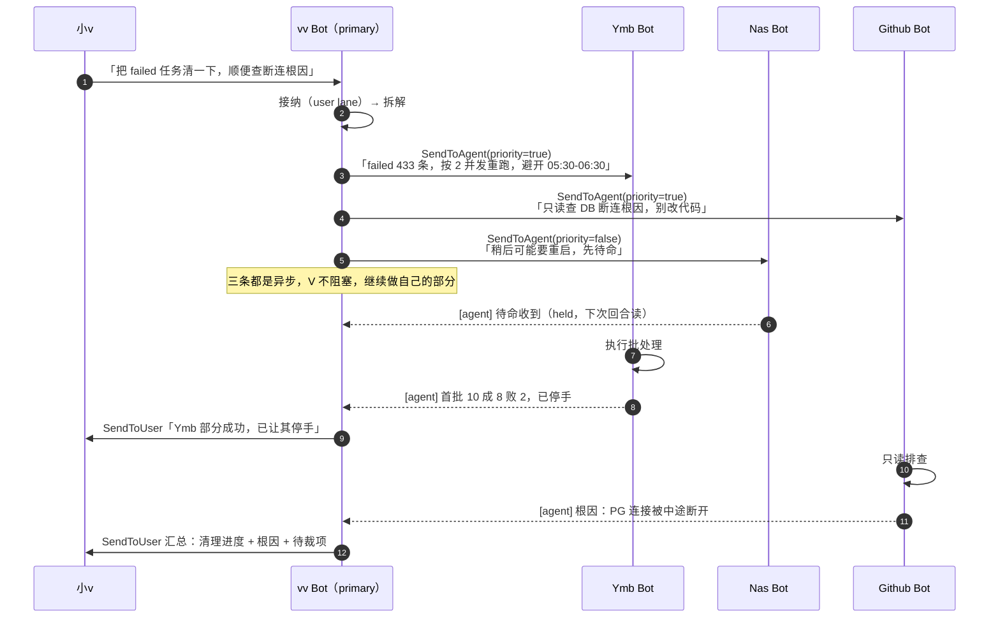

# 架构与调度图

## 当前本地架构（2026-10-22，P0/P1 后）

当前执行协议以 [EXECUTION.md](EXECUTION.md) 为准；功能入口见 [CORE_FEATURES.md](CORE_FEATURES.md)，编译与启动见 [BUILD_AND_RUN.md](BUILD_AND_RUN.md)。下文线上 bundle 图与标记 **F** 是外部历史证据，标记 **M（历史）** 是早期映射，均不代表当前执行保证。

| 层 | 当前实现 | 关键行为 |
| --- | --- | --- |
| 接入 | `gateway.mjs` / `host.mjs` | RPC 与 SSE；群入口先于单 Bot Proxy 路由 |
| 执行协调 | `execution.mjs` / `runtime.mjs` | 主机级 `execution.db` 以 WAL/FULL 保存接纳、Run、交互、任务与 outbox |
| 调度 | `scheduler.mjs` | 每 Bot 三 lane、单执行段；watchdog 请求取消，宽限期后记 `stuck` 并继续占槽 |
| 会话 | `conversation.mjs` / `db.mjs` | `dm:`、`group:`、`task:` 分区；输入水位固定；群只有一份业务历史 |
| 交互 | `runtime.mjs` | 卡片绑定 Run/callId；批准后同 Run 的新 segment 入队，工具与模型续跑均串行 |
| 群组 | `room.mjs` | fan-out、@ 定向、coordinated、round_robin；按成员 nonce/runId 查结果和取消 |
| 派工 | `tasks.mjs` | 本地 `delegate_task` 持久依赖与父恢复；普通 `message_agent` 不保证回复 |

`send-acceptance.json` 保留作兼容导入与诊断，已由协调库承担 Run 状态权威。崩溃前仍在执行的工作转为 `needs-reconciliation`，不自动重放工具；有持久恢复点的待决交互可恢复，无绑定旧卡过期。任务等待和交互等待释放实际执行槽，恢复始终重新排队。

回归基线为 **174 项：171 通过、3 跳过**；这是此前完整代码回归的结果，本次文档整理未新增 GUI 或打包验证。

## 历史重建与早期映射

以下历史图依据线上 bundle `2e44baf`（sha256 `e2caadd9…`）与 `sand-d` 快照。图用 Mermaid；`docs/FLOW.md` 是文字版，本文是图版。

图例：**实线** = 必然发生；**虚线** = 条件/异步；**灰色** = 线上存在但个人版未实现。

---

## 1. 整体分层：谁在跑，跑在哪

**读图要点**

- `harness=temporal` 的 bot，回合**从来不在 box 里跑**；box 负责接纳、排队、tail 缓存和回执。
- `harness=box` 或字段缺失会掉进 `send-pipeline`，而那条路最后一行是 `throw SandBoxHarnessRetiredError`——这是死路，不是慢路。
- `/cursor/stores` 是权威 transcript 的本地映射，`store.db` 里往往只有事件（快照里 9 个 bot 全空就是这个原因）。

---

## 2. 一次用户消息的完整时序

---

## 3. 排队：三 lane + watchdog

**F**：`RUN_WATCHDOG_DEFAULT_MS = 120000`，`RUN_WATCHDOG_GRACE_DEFAULT_MS = 30000`。watchdog 只在**有 user 任务在排**时才装。

---

## 4. bot 之间通讯

**F** 语义原文（`SEND_TO_AGENT_PRIORITY_DESCRIPTION`）：

> true：对方应当行动，或有人在等回复（任务、提问、交接、STOP、改计划）。立即送达并唤醒；若对方正在跟用户对话或处理另一个 bot 的消息，则排在其后。
> false：仅信息（状态更新、FYI、致谢、没人等的回复）。**held，等对方下次回合开头再读，不唤醒。**
> 群组忽略此项，总是立即 post。

其它约束：

| 规则 | 值 |
| --- | --- |
| 文本上限 | `AGENT_MESSAGE_MAX_TEXT_LENGTH = 8000` |
| 入站提示词 | `AGENT_INBOUND_WAKE_CUE = "[agent]"` |
| 幂等键 | `(toAgentId, messageId)`，账本上限 512 |
| 不能自消息 | `toAgentId === fromAgentId` → 拒绝 |
| 图片 | 1:1 可投；群组拒绝并回注说明 |
| priority | 仅 1:1；跨机也不支持，降级为普通发送 |

**M（历史）** 已按此实现 `sendToAgent` / `postToGroup` / 幂等账本；测试覆盖 priority 唤醒、held 不唤醒、幂等、群组只发文本。

---

## 5. 主 bot：不是权限，是"用户指定谁接活"

**F** `SetPrimaryBot` 工具描述的关键句：

> 把它**做成用户现有某个 agent 的 primary bot**：钉在侧栏顶端、用户最先派活的那个。**只有用户要求改**时才调用。调用前先把现有 bot 列出来、每人一句适不适合，问用户要哪个，等回答。

**所以"主 bot"不是超级用户**。它是：

- **用户指定**（不是自封、不是程序推断）
- **一个指针**（侧栏排序 + 默认收件人），不是权限提升
- **协调靠工具**：`SendToAgent` / `ListAgents` / `CreateAgent` / `UpdateAgent` / `ListSections`，全是普通工具调用
- **它拿不到别的 bot 的私有资料**——没有特权读取通道

配套工具：`WakeParent`（子 agent 唤醒父级）、`StopSubagent`、`ReadTranscript`（读别的会话记录需要明确 id）。

---

## 6. 群组（多 bot 房间）

**F** outcome 六态：`delivered` / `pass` / `skipped` / `timeout` / `cancelled` / `error`。`pass` 是"这轮我没什么可说"的正当结果，不是失败。

**F** 群组消息**纯文本**，图片会被拒并附说明；**priority 对群组无效**（不会打断成员）。

**M（历史）** 群组用 `group.json` 的 `memberIds`，`isGroup: true` 标记；广播时逐成员写 transcript，不唤醒。

---

## 7. 一个 bot 内部：回合循环

**审批与提问都是 entry，不是弹窗**：它们把回合停下来，写入 transcript，然后等一个显式解析来续跑。

---

## 8. 时间线：一次典型的多 bot 协作

历史时间线：用户派活给主 Bot；主 Bot 唤醒 Worker A，同时向 Worker B 留下 held 通知；A 的回复稍后抵达，B 在下次回合读取通知，主 Bot 再汇总。这里表达异步顺序，不作为执行时限。

关键：**派活是异步的**。主 bot 发完 `SendToAgent` 立刻继续，不阻塞等结果；worker 的回复作为新消息异步唤醒主 bot。

---

## 9. 主 bot 派工的一个具体例子

以 `sand-d` 快照里的真实名册为例（vv Bot 是幕僚长，下面挂 Ymb / Github / Nas）。

**为什么 Nas 用 `priority=false`**：它此刻没有要做的事，只是待命。用 `true` 会打断它的空闲回合、白跑一次；用 `false` 则等它下次被唤醒时自然读到。这正是 `priority` 存在的理由。

**为什么 V 不等待**：`SendToAgent` 的回执明说"This is asynchronous — if they reply, it'll arrive later as a new message that wakes you; don't wait on it now."

---

## 10. 早期个人版与线上的映射（历史快照）

| 环节 | 线上 `2e44baf` | mygrokbot | 状态 |
| --- | --- | --- | --- |
| gateway RPC + SSE | 212 方法 | 同词汇子集 | 已对齐 |
| 持久接纳 | `send-acceptance.json` 三态 lookup | `acceptance.mjs` | 已对齐 |
| 三 lane 队列 | user/agent/background | `scheduler.mjs` | 已对齐 |
| watchdog | 120s + 30s escape | 同 | 已对齐 |
| group-member 让路 | 有 | 有 | 已对齐 |
| harness 路由 | temporal/box/缺失 | 三态 + 拒绝语义 | 已对齐 |
| bot 通讯 | priority/held/幂等/群组 | 同 | 已对齐 |
| 主 bot | 用户指定的指针 | 同上（无特权） | 已对齐 |
| 群组房间回合 | `runRoomMemberTurn` 六态 outcome | 仅广播，无轮流发言 | **部分** |
| 回合执行 | 服务端 agent proxy | 本地 provider | 结构不同 |
| `/cursor/stores` FUSE | 权威存储 | 无 | 未实现 |
| 桌面/VNC | 3 常驻 + 5 shared，21 进程 | 无 | 未实现 |
| 错误分类 | 9+ 种 | 3 种 | 未对齐 |
