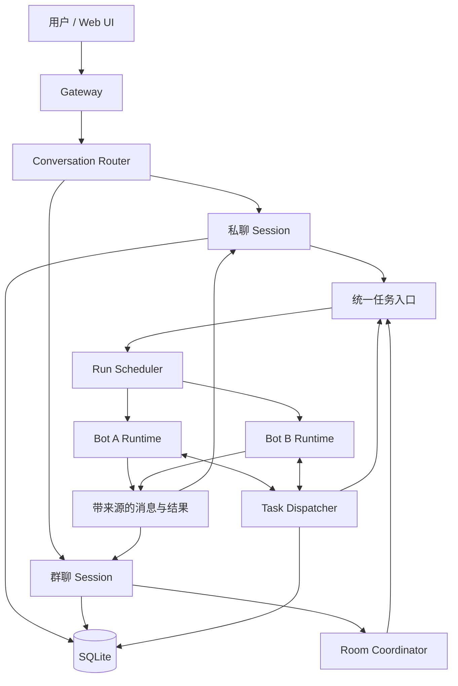

# MyGrokbot 多 Bot 协作审查：结论归档与代码级优化方案

> **复核更新（2026-10-22）：** 第二、三部分的判断与补丁建议已由[代码复核与改造建议](2026-10-22_architecture-mygrokbot-report.md)修订。本文保留前次整理过程，其中“被 @ 成员未落盘”“Room 超时后立即双活”等描述有误，部分补丁存在隔离回退和接口缺失。请以修订报告及其 21 项隔离观察为准，不将本页示例直接作为已验证补丁实施。第一部分是分享对话的整理摘要，不是逐字原文。

> 来源：ChatGPT 分享会话《项目初步审阅》第二轮（提问：「对多bot派发，群聊和私聊并存的情况进行深挖，然后结合grokbot和dsh chatbot的实现，给出你的分析以及存在的问题和优化分析」）。
> 分享链接：<https://chatgpt.com/share/6ad9b7b0-e374-83e8-b9b8-660158b4809f>
> 本文件第一部分为**原文观点提取**，第二部分为**本地代码复核**，第三部分为**可落地的改造方案与补丁级步骤**。
> 复核基线：本仓库 `mygrokbot/`，HEAD = `d498dd8 Groups: fan-out instead of model turns, isolation, @ addressing`，`src/` 共 5510 行。

---

## 第一部分 审查原文提取（第二轮：分析与建议）

### 1.1 核心结论

> MyGrokbot 目前最大的问题，不是多 Bot 派工接口不够丰富，而是 **Bot 身份、会话归属、任务执行和消息投递之间还没有形成稳定的一致性模型**。

代码已经复刻了不少原版 GrokBot 行为（`message_agent`、`priority`、`held`、三优先级调度队列、群聊、每 Bot 独立 Transcript），但私聊与群聊共存不只是给 Bot 加一个 groupId：同一个 Bot 同时承担四种工作——

1. 在自己的私聊中回答用户；
2. 收到其他 Bot 的私聊任务；
3. 作为群成员参与讨论；
4. 在后台执行定时任务或向其他 Bot 汇报。

这四种工作共享 Bot 身份，却不应天然共享同一份会话上下文、任务生命周期和消息输出位置。

### 1.2 严重程度总表（原文）

| 发现 | 严重程度 | 影响 |
|---|---|---|
| 同一个 Bot 的群聊来源用全局 Map 保存 | 高 | 群聊回答可能归属错误 |
| 同一个群聊存在两条独立执行路径 | 高 | 行为和上下文不一致 |
| 隐藏消息与后续可见上下文存在矛盾 | 高 | 群成员可能无法真正读取群消息 |
| 多 Bot 派工只有投递，没有任务完成协议 | 中高 | 主 Bot 难以可靠汇总结果 |
| 调度器按 Bot 而非会话串行 | 中高 | 私聊可能长期等待群聊任务 |
| 群聊轮次与取消机制存在竞态风险 | 中高 | 迟到结果、重复回复、状态覆盖 |

原文立场：**不否定架构方向**，保留 Gateway / Roster / ToolRuntime / Provider / SQLite，只重构会话与任务层，不引入微服务。

### 1.3 概念模型：四个对象必须分开

| 概念 | 表示什么 | 应当怎样管理 |
|---|---|---|
| Bot | 身份、角色、模型、技能、长期记忆 | 长期存在 |
| Conversation | 私聊、群聊或其他上下文空间 | 独立历史与参与者 |
| Task | 一项有目标、有结果的工作 | 有状态、有负责人 |
| Run / Turn | 模型推理和工具执行的一次过程 | 可中断、可重试、可追踪 |

> **Bot 拥有身份，Conversation 拥有历史，Task 拥有工作目标，Run 拥有执行状态。**

同一个 Bot 可在多个 Conversation 发言、处理多个 Task；不应因为都躺在 `agents/<uuid>/store.db` 里就被当成同一上下文。

### 1.4 三系统对照

| 维度 | GrokBot | DSH | MyGrokbot 当前 |
|---|---|---|---|
| 核心抽象 | 长期存在的 Bot | Agent、Session、Subagent Activation | 长期存在的 Bot |
| 群聊 | 原生支持 | 非核心 Subagent 语义 | 支持，但实现分叉 |
| Bot 间消息 | 异步投递与协作 | 受父子关系约束的消息与任务委派 | `message_agent` |
| 工作结果 | 会话可见交接 | 子任务结果及完成通知 | 普通消息为主 |
| 上下文 | 按 Bot/对话保留 | Session 日志与上下文投影 | 按 Bot Transcript |
| 生命周期 | 云端 Bot 长期运行 | Activation 管理与终止 | Turn + Scheduler |
| 扩展方式 | 平台内工具与服务 | 可插拔 Harness 组件 | 直接模块组合 |

借鉴方式：**保留 GrokBot 的 Bot 社交协作模式，借鉴 DSH 的执行 / 会话 / 任务管理方式**；不移植 DSH 的 Cordis 插件体系（单机单用户没必要）。

### 1.5 八个具体问题（原文）

**问题 1 — 存在两套互不统一的群聊引擎（P0）**
- 路径 A（真实 UI 路径）：`gateway.sendPrompt` → `engine.postFromOperator` → 遍历群成员各自 `engine.admit` → 成员各进 Bot 队列 → 完成后镜像回群。**这是独立派发，不是轮流发言，成员之间没有统一群轮次控制。**
- 路径 B（独立 RPC）：`gateway.runRoomTurn` → `rooms.runRound` → 逐个 `runMemberTurn` 并等待 → 记录 delivered / pass / skipped。**有轮次和结果状态，却没与常规群聊展示形成闭环。**
- 影响：普通群消息不会进入 `runRound()`，`pass`/轮次取消/成员结果管理不是常规能力；反过来直接调 `runRoomTurn` 时，成员没有隐藏群上下文，回复也不写回群 Transcript。
- 建议：保留一个 `RoomCoordinator`，UI / API / Bot 主动发言走同一入口，`runRound` 降为内部可选调度策略。

**问题 2 — Bot 群聊来源绑在 Bot 身份上（P0，可直接确认的竞态）**
- `this.groupOrigin = new Map() // agentId -> groupId`，群触发时 `set(memberId, groupId)`，完成时 `mirrorToGroup` 读取并删除。
- 一个 Bot 可同时在多个群，Map 只保留最后一个群 ID：

| 时刻 | 事件 | groupOrigin[Bot A] |
|---|---|---|
| T1 | 群聊甲要求 Bot A 分析代码 | 甲 |
| T2 | 群聊乙要求 Bot A 分析日志 | 乙 |
| T3 | Bot A 完成群聊甲任务 | 乙 |
| T4 | 结果写入乙，Map 被删除 | 空 |
| T5 | Bot A 完成群聊乙任务 | 空 |

- 结果：**甲的答案写进乙，乙的答案丢失**。单群连续多条消息同样会触发。
- 正确做法：来源属于每一次执行 —— `RunContext { runId, botId, conversationId, triggerMessageId, taskId? }`；`hidden` 也应是每条记录的属性，而非 Bot Store 上的全局开关。

**问题 3 — 群消息存下来了，模型不一定读得到（P0）**
- `postFromOperator` / `postToGroup` 把部分群消息以 `hidden: true` 写进成员 Store，注释指望"以后能读到"；
- 但 `buildMessages()` 把隐藏条目与隐藏回合整体排除，只对当前回合破例。
- 矛盾：为私聊隔离而隐藏 ↔ 为群聊连续性需要读群消息 ↔ 上下文构建没有区分"从私聊读"与"从群聊读"。
- 表现：**群里的 Bot 不知道其他 Bot 刚说了什么。** 加 `[group:群名]` 前缀解决不了，因为进不进模型输入由 `buildMessages()` 决定。
- 建议：`buildMessages(botId, conversationId)`，群聊从 Room Transcript 取有序消息，再叠加角色与长期记忆；私聊只读私聊历史。

**问题 4 — Bot 主动发群消息可能根本没投递（P0，确定的数据源不一致）**
- `roster.createGroup()` 把成员写在 `agents/<groupId>/group.json`，正确读法是 `roster.groupMembers(groupId)`；
- 但 `engine.postToGroup()` 读的是 `roster.profile(groupId).memberIds` —— 正常建群路径下为空。
- 后果：`delivered: true` 但无人收到，群时间线也没有这条发言。
- 测试盲区：e2e 群聊用例用 `roster.create({isGroup:true, memberIds:[...]})` 构造，绕开真实路径。
- 修复要同时做两件事：统一从 `group.json` 取成员；**先落盘群聊原始消息，再处理投递/唤醒**。

**问题 5 — 私聊派工不是闭环（P1，语义缺口）**
- `sendToAgent()` 实际只做：写 B 的 Transcript → 写 A 的出站记录 → `priority=true` 时唤醒 B → B 执行自己的回合。
- 缺最关键一环：**B 完成后，结果凭什么是 A 的哪个任务？** 没有父任务 ID、结果归属、自动回传协议。
- 入站记录虽存 `fromAgent`，但 `buildMessages()` 主要用 `[agent] ...` 文本，未把发送者身份、回复目标、任务关系明确表达给模型 —— 不能靠模型猜收件人。
- 至少需要 `taskId`、`parentTaskId`、`returnConversationId`。

**问题 6 — 审批恢复破坏群聊/私聊隔离（P0）**
- `runTurn()` 处理隐藏群回合时设 `store.hideWrites = true`；但遇到需审批工具或 `ask_user` 会提前 `return`，走不到正常结束处 `hideWrites = false`。
- 后果一：后续写入同一 Bot Store 的**私聊记录也被错误标记为隐藏**。
- 后果二：批准后新建的 Acceptance **没有继承原群聊来源与隐藏状态**，回答可能跑到私聊里。
- `answerWidget()` 同类问题。另：`resolveApproval()` 拒绝分支引用了未定义的 `turnId`。
- 建议：群内正常问答可原群处理；需操作员批准的动作产生明确待处理状态，在私聊或统一审批面板处理；批准后恢复原 `runId` 的会话与任务；原任务已取消则不得继续。

**问题 7 — 调度器可能在一个 Bot 内放出两个并发 Run（P0）**
- `RunScheduler` 的"每 Bot 一个 Active Run"原则本身正确；
- 但 `escapeWedgedRun()` 遇长期阻塞会清空 Active 并放行下一个，只靠 Generation 阻止迟到的 Promise 改状态。
- **Generation 能防迟到结果重占队列，防不住被放弃的模型调用 / 工具继续产生副作用**：

```text
Bot A 正在执行群聊任务 R1
    ↓ 用户在私聊发送 R2，R2 等待超时
Scheduler 释放 R1
    ↓ R2 开始执行
R1 实际上还在执行文件操作
    ↓ R1 与 R2 的工具和状态交错
```

- `TurnEngine` 的 `aborts`、`running` 又以 `agentId` 为键，更易互相覆盖。
- 建议：① 调度器对相应 `runId` 的 AbortController 发取消；② 等可取消部分退出并为每个 Run 设终结状态；③ 无法立即终止的外部操作禁止再写状态；④ 确认旧回合停止前不放行同 Bot 新回合。

**问题 8 — RoomTurns 的轮次结果不一定属于当前成员回合**
- `awaitMember()` 完成后调 `lastAssistantText(acceptance.agentId)`，在该 Bot 最近 Transcript 里找助手文本，**没有用 `turnId` / `clientNonce` / `entryId` 验证归属**，群私交替时可能误取上次私聊输出。
- 独立竞态：旧轮次结束直接 `this.turns.delete(room)`，不确认 Map 中仍是自己，新轮次可能被旧轮次清掉。
- 修正：`runMemberTurn()` 直接取对应 `runId` 的终结结果，而不是事后扫描最近消息。

### 1.6 多 Bot 派工缺的语义（原文）

**Message ≠ Task**

| 类型 | 例子 | 要求 |
|---|---|---|
| Message 发消息 | "GitHub Bot，我已完成了配置检查" | 只要求准确送达，不启动任务，不保证回复 |
| Task 委派工作 | "审查调度器，把结论交给主 Bot" | 必须有任务身份、目标、负责人、完成/失败状态、返回目标 |

当前 `message_agent(priority=true)` 同时承担两者，但 `priority` 只决定是否唤醒与用哪个队列。

**建议的最小任务生命周期**：`created → queued → running → {completed | failed | cancelled | waiting}`，`waiting` 为非终态。任务完成时运行时自动把结果交回父任务。新增轻量 `delegate_task`，`message_agent` 保留为普通消息工具。

**防无限循环建议初始值**：活动委派上限 4；自动嵌套深度上限 2；`messageId` / `taskId` 贯穿任务链，重复通知不产生新任务；自动通知默认不唤醒 Bot；"收到/谢谢"不生成完整模型回合。

### 1.7 目标架构（原文 Mermaid）



关键：**私聊与群聊共用 Bot Runtime，但不共用会话状态；派工与普通消息可复用投递基础设施，但不共用不明确的完成语义。**

群聊收敛为**一套 Coordinator + 三种策略**：定向响应（只 @ 的执行）/ 协调响应（默认接活，必要时派工）/ 讨论轮次（依次邀请，可 pass）。普通群消息统一持久化到群 Session；被点名只决定谁执行。成员发言后不自动无限唤醒全员，下一轮由 Coordinator 决定。

调度仍按 Bot 串行，但队列项带上完整会话与任务身份；优先级：私聊指令 > 明确 @ 的群任务 > 其他 Bot 委派 > 群普通讨论/后台。

### 1.8 测试体系：围绕"交叉场景"重设计（原文用例表）

| 测试 | 操作 | 必须满足的结果 |
|---|---|---|
| 群成员连续发言 | A 发言后 B 接着发言 | B 能读取 A 的群聊内容 |
| 群聊与私聊交替 | 群甲任务执行时发送私聊 | 两种回复分别归属原会话 |
| 两个群共用 Bot | 甲、乙同时给 A 发任务 | 不串群、不丢回复 |
| Bot 主动群发 | A 向正常创建的群发消息 | 群时间线可见，成员可读取 |
| 群聊审批 | 群任务请求 shell 审批 | 私聊不被隐藏，审批后恢复原任务 |
| 群聊取消 | 取消轮次后收到迟到模型输出 | 不产生新的群回复 |
| 私聊派工 | A 派任务给 B | B 的结果回到 A 的原任务 |
| 重复发送 | 重发相同 nonce 的群消息 | 不重复写入、执行或通知 |
| 长任务抢占 | 群任务运行时用户直接找 Bot | 无同 Bot 双活、无状态覆盖 |
| 多 Bot 循环 | A→B→C→A 反复派工 | 达到约束后明确停止并报告 |

两个自动化不变量：**会话隔离**（模型输入只能来自所属 Conversation 或显式授权引用）、**输出归属**（每个 Run 的可见输出绑定固定目标，不得按执行结束时的全局活动群推断）。

### 1.9 改造优先级（原文）

- **P0 消息不错位**：`postToGroup` 成员来源、群消息落盘、`groupOrigin` 竞态、隐藏写入状态泄漏、审批恢复、Scheduler 双活。不追求功能，只保证不污染会话、不误执行。
- **P1 统一群聊执行与会话上下文**：合并 `postFromOperator` 与 `RoomTurns`；Run 增加 Conversation 身份；`buildMessages()` 按当前会话构建输入；之后再实现稳定 `@Bot`、回复定向、轮次控制。
- **P2 多 Bot 派工闭环**：轻量 `TaskDispatcher`，任务 ID、父子关系、结束通知、失败传递、取消、返回目标；保留 `message_agent` 自由通信。
- **P3 可观测性**：UI 显示任务来源、负责人、派发链、状态、等待原因、结果归属（简易任务详情面板，不必重做 Trajectory）。

**取舍建议**：保留现有 Transcript Entry 与流式更新，另为任务状态转换、消息投递、审批决议、取消事件建一份**追加式执行日志**（审计 + 崩溃后判断未交付任务）。

### 1.10 最终判断（原文）

分工：**GrokBot 决定协作体验，DSH 提供执行体系参考，MyGrokbot 选择最轻量可验证的实现。**

三条边界：**Bot ≠ Conversation；消息 ≠ 任务；回合结束 ≠ 任务完成。**

> 最值得优先做的：将群聊收敛为一个统一的消息与轮次入口，将执行上下文从 Bot 全局状态转移到 Run，再为跨 Bot 委派加入最小的 Task 生命周期。

> 原文限定：上述代码问题属于静态审查发现，尚未通过本地并发压力测试逐项复现。

---

## 第二部分 本地代码复核（2026-10-22，HEAD `d498dd8`）

逐条对照源码后的结论：**8 个问题中 7 个在本仓库可复现确认，1 个部分成立**。原文基于 GitHub main 的静态阅读，本地代码结构一致，行号已按本仓库校正。

| # | 原文判定 | 本地复核 | 证据位置 | 备注 |
|---|---|---|---|---|
| 1 | 双群聊引擎 | ✅ 成立 | `gateway.mjs:175-180`（`runRoomTurn`）、`gateway.mjs:326-338`（isGroup → `postFromOperator`）、`engine.mjs:1017`、`room.mjs:48` | UI 走 fan-out，`runRound` 仅由 RPC 触发 |
| 2 | `groupOrigin` 竞态 | ✅ 成立 | `engine.mjs:61`、`engine.mjs:1063`、`engine.mjs:997-999` | Map 以 agentId 为键，Bot 级而非 Run 级 |
| 3 | 隐藏消息读不到 | ✅ 成立（比原文更彻底） | `engine.mjs:131-147`、`engine.mjs:1049-1058` | 详见下文"复核加强" |
| 4 | `postToGroup` 成员来源错误 | ✅ 成立 | `engine.mjs:1088-1089` vs `roster.mjs:137`、`roster.mjs:105-127` | `profile.memberIds` 默认不存在 |
| 5 | 派工无闭环 | ✅ 成立 | `engine.mjs:881-940`（无 taskId/returnTo） | 仅 messageId 幂等 |
| 6 | 审批恢复破坏隔离 | ✅ 成立 | `engine.mjs:398`、`engine.mjs:560/598-600`、`engine.mjs:704`、`engine.mjs:662` | `parked` 提前 return 无 finally |
| 7 | 调度器双活 | ✅ 成立 | `scheduler.mjs:269-296`（`escapeWedgedRun` 不 abort）、`scheduler.mjs:206-217`（`forceRelease` 同样不 abort） | 只有队列槽位释放 |
| 8 | RoomTurns 结果归属 | ✅ 成立 | `room.mjs:185-190`（`lastAssistantText`）、`room.mjs:93`（`turns.delete(room)`） | 无 turnId 校验 |

### 2.1 复核加强：问题 3 实际比原文更严重

原文认为"隐藏消息存了但读不到"。本地代码显示**两条路径的行为相反，且都不可用**：

```js
// engine.mjs:1049 —— 未被 @ 的成员：写入 hidden 行，指望以后能读
const row = agentInboundEntry({...});
row.hidden = true;
store.appendEntry(row);

// engine.mjs:1062 —— 被 @ 的成员：完全不写成员 Store，只置 groupOrigin
// "Group traffic belongs to the room only"
this.groupOrigin.set(memberId, groupId);
this.admit({ agentId: memberId, prompt: withFiles, trigger: 'group', hidden: true });
```

- 没被 @ 的成员：消息以 `hidden` 落盘 → `buildMessages()` 排除 `hidden` 条目 → **永远读不到**。
- 被 @ 的成员：prompt 直接进模型 → 这一轮看得到 → 但成员 Store 无记录，下一轮**完全失忆**。

所以群聊里 **Bot 既读不到别人的话，也记不住自己说过什么**，`hidden` 机制在两端都没达成目的。这直接印证原文"不能只靠 `[group:群名]` 前缀解决"。

### 2.2 复核加强：问题 6 的泄漏范围比原文描述更大

原文说"提前 return 时 `hideWrites` 未复位"。本地确认 `runTurn` 无 `try/finally` 兜底，`parked` 分支直接 `return`：

```js
// engine.mjs:596-600
acceptance.state = 'awaiting-approval';
this.running.delete(agentId);
this.parked.set(agentId, { acceptance, approvalEntryId: approval.id, turnId });
return;                       // ← hideWrites 仍为 true
```

且 `parked` 期间同 Bot 的**任何**写入（包括用户私聊、后台 routine）都会在 `db.mjs:202` 被强制打上 `hidden: true`：

```js
const row = this.hideWrites && !entry.hidden ? { ...entry, hidden: true } : entry;
```

即：一次群聊审批会把该 Bot 的**整段待审期间的私聊全部吞掉**，直到下一次隐藏回合正常结束才复位。原文的"后续私聊被误标隐藏"属实，但影响面应写成"parked 全生命周期内的所有写入"。

### 2.3 复核加强：问题 7 有第二个更易触发的入口

原文只提到 `escapeWedgedRun()`。本地另有 `forceRelease()`（`scheduler.mjs:206`），由 `engine.interrupt()` 在"无 stream 但 running 残留"时调用，**同样只置空 active + reject，不发 abort**：

```js
forceRelease(agentId, reason = 'forced release') {
  const queue = this.queues.get(agentId);
  const active = queue?.active;
  if (!active) return false;
  queue.active = null;
  this.disarmWatchdog(queue);
  try { active.item.reject(new Error(reason)); } catch { /* already settled */ }
  active.markSettled?.();
  this.pump(agentId);          // ← 旧 Run 的 fetch / 工具仍在跑
  return true;
}
```

`engine.aborts` / `engine.running` 均以 `agentId` 为键（`engine.mjs:388`、`engine.mjs:677`），新 Run 覆盖旧键后，旧 Run 的 `catch` 里读 `this.aborts.get(agentId)` 得到的是**新 Run 的** controller，aborted 判定与清理都会错。

### 2.4 复核加强：问题 4 的测试盲区确认

```js
// test/e2e.test.mjs:207
const group = host.roster.create({ name: 'Ops Room', isGroup: true, memberIds: [] });
host.roster.update(group.id, { memberIds: [m1.id, m2.id, agentId] });
```

`roster.create()` 把 `memberIds` 原样写进 `profile.json`，`roster.update()` 同样写 profile，**都不写 `group.json`**；而 `groupMembers()` 只读 `group.json`。于是 e2e 用例恰好构造出 `postToGroup` 能工作的假象：`profile.memberIds` 有值、`groupMembers()` 为空。

生产路径 `createGroup()` 只写 `group.json`（`roster.mjs:124`）→ `profile.memberIds` 不存在 → `postToGroup` 得到空数组。**测试通过恰恰掩盖了缺陷。**

同一不一致还影响 `postFromOperator`：它用 `groupMembers()` 取成员（正确），所以用户发言能送达、Bot 主动发言不能 —— 表现是"群里 Bot 只会答、不会主动说"。

### 2.5 原报告未覆盖的本地问题（追加 3 条）

| # | 问题 | 证据 | 影响 |
|---|---|---|---|
| 9 | `runTurn` 无 `try/finally`，`hideWrites` / `running` / `aborts` 全靠分支显式清理 | `engine.mjs:382-720` | 任何异常分支（除已列举的两处）都会残留状态 |
| 10 | `room.mjs` 的 `admit` 走 `lane: 'background'` + `source: 'group-member'`，但调度器对 background lane 无限流也无 abort 传播 | `room.mjs:126-132`、`scheduler.mjs:49-53` | 群轮次超时后成员回合仍在跑，下一轮同成员再入队即双活 |
| 11 | `postToGroup` 声称 `priority` 只影响 1:1，但 `sendToAgent` 对群目标直接透传 `priority` 并返回 `delivered: true` | `engine.mjs:889`、`engine.mjs:1114-1119` | 模型侧拿到成功回执，实际是无投递 |

---

## 第三部分 优化方案

总体策略与原文一致：**不动 Gateway / Roster / ToolRuntime / Provider / SQLite 的骨架，只新增三层** —— Run 身份、Conversation 归属、Task 生命周期。全部改造可在现有模块内完成，不需要新数据库、不需要新服务。

### 3.0 改造切片总览

| 阶段 | 目标 | 触及文件 | 预估规模 | 验收 |
|---|---|---|---|---|
| S0 | 止血：不串群、不吞消息、不双活 | `engine.mjs`、`scheduler.mjs`、`roster.mjs` | ~180 行 | 第二部分 11 条全部有对应用例 |
| S1 | Run 身份 + Conversation 上下文 | `engine.mjs`、新增 `conversation.mjs` | ~250 行 | 会话隔离不变量测试通过 |
| S2 | 统一群聊入口 RoomCoordinator | 新增 `coordinator.mjs`、`gateway.mjs`、`room.mjs` | ~320 行 | 三种策略可切换、fan-out 与 round 同源 |
| S3 | TaskDispatcher 闭环 | 新增 `tasks.mjs`、`tools.mjs`、`db.mjs` | ~280 行 | 委派回传、循环上限、取消传递 |
| S4 | 执行日志与可观测性 | 新增 `eventlog.mjs`、UI | ~200 行 | 崩溃后可判断未交付任务 |

---

### 3.1 S0 —— 止血补丁（P0，先合这个）

#### 补丁 A：`postToGroup` 统一成员来源 + 先落盘后投递

```js
// src/engine.mjs — 替换 postToGroup
async postToGroup({ fromAgentId, groupId, text, images = [], priority = false, taskId = null }) {
  const group = this.roster.profile(groupId) ?? {};
  const groupName = group.name ?? groupId;
  // FIX 1: 唯一真源 group.json（与 postFromOperator 一致）
  const members = this.roster.groupMembers(groupId);
  const from = this.roster.summary(fromAgentId);
  const note = [];
  if (images.length) note.push('the attached image(s) were NOT delivered — group messages are text-only');
  if (priority) note.push('priority is 1:1 only — this post did not interrupt members');

  // FIX 2: 先把原始发言写进群聊时间线，投递失败也留痕
  const roomStore = this.roster.store(groupId);
  const origin = {
    kind: 'send-message',
    id: `msg-${randomUUID()}`,
    fromAgent: { id: fromAgentId, name: from?.name ?? fromAgentId },
    message: { type: 'text', content: text },
    timestampMs: Date.now(),
    ...(taskId ? { taskId } : {}),
  };
  roomStore.appendEntry(origin);
  this.bus.publish({ type: 'transcript', agentId: groupId, entry: origin });

  const delivered = [];
  for (const memberId of members) {
    if (memberId === fromAgentId) continue;
    const store = this.roster.store(memberId);
    const entry = agentInboundEntry({
      from: { id: fromAgentId, name: from?.name ?? fromAgentId },
      text, images: [], priority: false,
    });
    entry.message.content = this.groupInboundText(groupName, text);
    // FIX 3: 不再 hidden —— 群成员需要读到别人说了什么（见 S1 的 buildMessages）
    entry.conversationId = groupId;   // S1 字段，S0 阶段可先写
    store.appendEntry(entry);
    this.bus.publish({ type: 'transcript', agentId: memberId, entry });
    delivered.push(memberId);
  }

  // FIX 4: 回执反映真实投递结果
  return {
    delivered: delivered.length > 0,
    groupId,
    members: delivered,
    roomEntryId: origin.id,
    priority: false,
    ...(delivered.length === 0 ? { reason: 'group has no members in group.json' } : {}),
    ...(note.length ? { notes: note } : {}),
  };
}
```

#### 补丁 B：`groupOrigin` → 以 `runId` 为键

最小改动版（S0 用，S1 会被 `RunContext` 取代）：

```js
// engine.mjs 构造函数
this.runOrigins = new Map(); // runId -> { conversationId, kind: 'group' }

// postFromOperator 内
this.groupOrigin.set(memberId, groupId);
// ↓ 改为：先把 conversationId 绑到 acceptance 上
const accepted = this.admit({
  agentId: memberId,
  prompt: withFiles,
  trigger: 'group',
  hidden: true,
  conversationId: groupId,          // 新增
});
// admit 内部：acceptance.conversationId = conversationId

// runTurn 正常结束处
if (acceptance.hidden) {
  store.hideWrites = false;
  this.mirrorToGroup(acceptance);           // 传 acceptance 而非 agentId
  this.hideTurn(agentId, turnId);
}

mirrorToGroup(acceptance) {
  const groupId = acceptance.conversationId;
  if (!groupId) return;
  const body = String(accumulatedRef ?? '').trim();
  if (!body) return;
  /* 写入群 store，逻辑不变 */
}
```

**这样两个群同时触发 Bot A 时，各自 answer 写回各自 conversationId，不再互相覆盖。**

#### 补丁 C：`hideWrites` 用 `try/finally` 兜底

```js
// engine.mjs runTurn —— 把 hideWrites 的开启/关闭收进 finally
async runTurn({ agentId, acceptance }) {
  const binding = resolveBinding(this.p.root, agentId);
  const store = this.roster.store(agentId);
  const turnId = randomUUID();
  const prevHideWrites = store.hideWrites;          // 记录并恢复，不做布尔假设
  if (acceptance.hidden) store.hideWrites = true;
  try {
    /* ……原主体，删除所有 704 行的 store.hideWrites = false …… */
  } finally {
    store.hideWrites = prevHideWrites;             // parked 分支也会复位
    if (acceptance.state !== 'awaiting-approval' && acceptance.state !== 'awaiting-answer') {
      this.running.delete(agentId);
    }
  }
}
```

注意 `parked` 分支要保留 `this.parked.set(...)`，但不再需要"手动复位 hideWrites"这件事本身。

#### 补丁 D：审批恢复继承来源

```js
// engine.mjs resolveApproval —— 在构造新 acceptance 时继承
const parked = this.parked.get(id);
const acceptance = {
  clientNonce: nonce,
  agentId: id,
  entryId,
  acceptedAtMs: Date.now(),
  state: 'accepted',
  trigger: 'approval-resume',
  // FIX: 继承原 Run 的会话身份与隐藏语义
  conversationId: parked?.conversationId ?? null,
  hidden: parked?.hidden === true,
  originTaskId: parked?.taskId ?? null,
};
```

`answerWidget()` 同样处理。同时修 `resolveApproval` 拒绝分支的未定义 `turnId`：

```js
const parkedTurnId = this.parked.get(id)?.turnId ?? null;
store.appendEntry(noticeEntry(`approval denied: ${command}`, { level: 'warn', turnId: parkedTurnId }));
```

#### 补丁 E：调度器释放槽位必须 aborts

```js
// scheduler.mjs —— escapeWedgedRun / forceRelease 统一走这个
_releaseWithAbort(agentId, queue, active, reason) {
  // 1) 先请求取消（abort 由 engine 注册到 item 上）
  try { active.item.abort?.(reason); } catch { /* ignore */ }
  // 2) 给可取消部分一个短窗口退出，不阻塞队列
  const graceMs = this.abortGraceMs ?? 2_000;
  this.clock.schedule(graceMs, () => {
    // 3) 仍未退出：标记为隔离，禁止其后续写状态
    active.item.quarantine?.();
  });
  queue.active = null;
  queue.zombies.add(active.settled);
  void active.settled.then(() => queue.zombies.delete(active.settled));
  this.pump(agentId);
}
```

对应 `engine.enqueue` 把 abort 能力挂到 item 上：

```js
this.scheduler.enqueue(agentId, job, {
  lane, source, acceptedAtMs, ackToken,
  abort: (reason) => {
    const a = this.acceptances.get(ackToken);
    if (a) { a.abortRequested = true; a.quarantined = true; }
    this.aborts.get(ackToken)?.abort();   // ← S0 临时把 aborts 改成 nonce 为键
  },
});
```

**关键点：`aborts` / `running` 的键从 `agentId` 换成 `clientNonce` / `turnId`**，这是消除问题 7 的第二层根因（新 Run 覆盖旧键）。

#### 补丁 F：测试修正（否则前面的修复无法验证）

```js
// test/e2e.test.mjs:207 —— 改用真实建群路径
const group = host.roster.createGroup({ name: 'Ops Room', memberAgentIds: [m1.id, m2.id, agentId] });
// 断言追加：群时间线里必须有这条发言
const roomT = await rpc('getAgentTranscript', { agentId: group.id });
assert.ok(roomT.result.some((e) => e.kind === 'send-message' && /standup at 10/.test(e.message.content)));
```

---

### 3.2 S1 —— Run 身份与 Conversation 上下文

#### 新增 `src/conversation.mjs`

```js
// Conversation 是"历史归属"，Run 是"执行归属"。两者都不进 profile.json。
export const CONVERSATION_DM = (botId) => `dm:${botId}`;
export const CONVERSATION_GROUP = (groupId) => `group:${groupId}`;
export const CONVERSATION_TASK = (taskId) => `task:${taskId}`;

export function makeRunContext({ botId, conversationId, triggerMessageId, taskId = null }) {
  return { runId: `run-${crypto.randomUUID()}`, botId, conversationId, triggerMessageId, taskId, startedAtMs: Date.now() };
}
```

Entry 侧只需三个可选字段，SQLite schema 不变（JSON Entry 直接吃下）：

```js
{ conversationId?: string, runId?: string, taskId?: string }
```

`db.mjs` 的 `readWindow` / `readTail` 增加按 `conversationId` 过滤的选项即可。

#### `buildMessages` 改为按会话构建

```js
// engine.mjs
buildMessages(agentId, { conversationId = null, keepRunId = null } = {}) {
  const store = this.roster.store(agentId);
  const all = store.readAll({ includeToolCalls: true });

  // 该 Run 要看的消息来自两处：
  //   a) Bot 自己的记录里属于本会话的那些行
  //   b) 群聊时：群 store 的有序时间线（这才是"别人刚说了什么"）
  const own = all.filter((e) => !e.partial && e.conversationId === conversationId);
  const roomRows = conversationId?.startsWith('group:')
    ? this.roster.store(conversationId.slice(6)).readAll({ includeToolCalls: true })
        .filter((e) => e.kind === 'message' || e.kind === 'send-message')
    : [];

  const entries = mergeByTimestamp(own, roomRows);   // 按 timestampMs + seq 排序
  /* ……后续 tool-call 配对逻辑保持原样，但不再有 hiddenTurn 过滤…… */
}
```

配套：`hidden` 从"跨会话隔离机制"降级为"UI 展示偏好"，**不再作为上下文过滤条件**。会话隔离由 `conversationId` 保证，这是原文问题 3 的根本解法。

#### `admit` / `runTurn` 串联

```js
admit({ agentId, prompt, clientNonce, conversationId = null, trigger, lane, source, hidden, taskId = null }) {
  const ctx = makeRunContext({
    botId: agentId,
    conversationId: conversationId ?? CONVERSATION_DM(agentId),
    triggerMessageId: entryId,
    taskId,
  });
  const acceptance = { clientNonce, agentId, entryId, ctx, /* … */ };
  /* enqueue */
}
```

`mirrorToGroup` 改成 `mirrorToConversation(acceptance, text)`，读 `acceptance.ctx.conversationId`，与全局状态彻底解耦。

---

### 3.3 S2 —— RoomCoordinator：一套引擎三种策略

`room.mjs` 现在只是 `runRound`，`postFromOperator` 是另一套。合并为：

```js
// src/coordinator.mjs
export const STRATEGIES = ['directed', 'coordinated', 'round_robin'];

export class RoomCoordinator {
  constructor({ roster, engine, rooms, bus }) { /* … */ }

  // 唯一入口：UI 发帖、RPC、Bot 主动发言都走这里
  async post({ groupId, text, from = { id: 'operator', name: 'operator' }, strategy = 'coordinated', onlyMemberIds = null, clientNonce = null, taskId = null }) {
    const entry = this._persistRoomMessage(groupId, text, from, clientNonce, taskId); // 先落盘
    const members = this.roster.groupMembers(groupId);
    const targets = this._selectTargets({ members, text, strategy, onlyMemberIds });
    const runs = await Promise.all(targets.map((memberId) => this._startMemberRun({
      groupId, memberId, entry, strategy, taskId,
    })));
    return { groupId, roomEntryId: entry.id, strategy, members: targets, runs };
  }

  _selectTargets({ members, text, strategy, onlyMemberIds }) {
    if (strategy === 'directed') {
      const explicit = onlyMemberIds?.length ? onlyMemberIds : this._parseMentions(members, text);
      return explicit.length ? explicit : [];               // 无人被 @ 就没人答
    }
    if (strategy === 'round_robin') return members;         // 由 rooms.runRound 串行驱动
    return this._pickCoordinator(members);                  // coordinated：默认一个负责人
  }

  _startMemberRun({ groupId, memberId, entry, strategy, taskId }) {
    // 所有成员一律 hidden:false，来源由 conversationId 决定
    return this.engine.admit({
      agentId: memberId,
      prompt: this._buildPrompt({ groupId, memberId, entry, strategy }),
      conversationId: CONVERSATION_GROUP(groupId),
      trigger: 'group',
      lane: strategy === 'round_robin' ? 'background' : 'user',
      source: 'group-member',
      taskId,
    });
  }
}
```

`gateway.sendPrompt` 遇到 `isGroup` 不再直接调 `engine.postFromOperator`，改为：

```js
if (roster.profile(id)?.isGroup === true) {
  return coordinator.post({
    groupId: id,
    text: String(prompt),
    strategy: roomSettings.strategy ?? 'coordinated',
    onlyMemberIds: mentionAgentIds?.map((m) => roster.resolve(m)) ?? null,
    clientNonce,
  });
}
```

`runRoomTurn` 保留为 `strategy: 'round_robin'` 的兼容别名，内部仍走 `rooms.runRound`，但把 `lastAssistantText()` 换成 run 级结果：

```js
// room.mjs awaitMember —— 不再扫最近消息
if (st.state === 'done') {
  const said = st.acceptance?.resultText ?? '';   // engine 在 turn-end 时写入 acceptance
  return { state: isPass(said) ? 'pass' : said ? 'delivered' : 'pass', text: said };
}
```

`engine.runTurn` 结束时补一行：`acceptance.resultText = accumulated;`（`agentInboundEntry` 已有同类模式）。

`turns.delete(room)` 加代际校验：

```js
if (this.turns.get(room)?.generation === turn.generation) this.turns.delete(room);
```

---

### 3.4 S3 —— TaskDispatcher 闭环

#### 工具拆分

```js
// tools.mjs —— message_agent 保留自由通信
{ name: 'message_agent', /* 不变 */ }

// 新增 delegate_task：任务语义，不带唤醒歧义
{
  name: 'delegate_task',
  description: 'Delegate a unit of work to another bot. The result is delivered back to the caller automatically. Use message_agent for plain messages.',
  args: {
    to: 'string',
    objective: 'string',
    expectedOutput: 'string?',
    parentTaskId: 'string?',      // 嵌套委派时由运行时注入
  },
}
```

#### 生命周期实现（`src/tasks.mjs`）

```js
export const TASK_STATES = ['created', 'queued', 'running', 'completed', 'failed', 'cancelled', 'waiting'];

export class TaskDispatcher {
  constructor({ db, roster, engine, bus, limits = {} }) {
    this.limits = { maxActive: 4, maxDepth: 2, ...limits };
  }

  async create({ fromBotId, toBotId, objective, expectedOutput = null, parentTaskId = null, returnConversationId }) {
    const parent = parentTaskId ? this.get(parentTaskId) : null;
    const depth = (parent?.depth ?? 0) + 1;
    if (depth > this.limits.maxDepth) throw new Error(`delegation depth ${depth} exceeds ${this.limits.maxDepth}`);
    if (this.countActive(fromBotId) >= this.limits.maxActive) throw new Error('active delegation limit reached');

    const task = {
      id: `task-${crypto.randomUUID()}`,
      parentTaskId, depth,
      fromBotId, toBotId,
      objective, expectedOutput,
      returnConversationId,          // ← 固定返回目标，不靠执行结束时的全局状态
      state: 'created',
      createdAtMs: Date.now(),
    };
    this.persist(task);              // 追加式写入 task 表（TEXT 主键 + JSON）
    this.bus.publish({ type: 'task-created', task });

    const conversationId = CONVERSATION_TASK(task.id);
    const entry = this.engine.appendInbound(toBotId, {
      from: fromBotId, text: this.buildPrompt(task), conversationId, taskId: task.id,
    });
    this.transition(task, 'queued');
    this.engine.admit({
      agentId: toBotId, prompt: this.buildPrompt(task),
      conversationId, trigger: 'delegate', lane: 'agent', source: 'agent', taskId: task.id,
      onSettled: (result) => this.complete(task.id, result),
    });
    return task;
  }

  complete(taskId, { text, error }) {
    const task = this.get(taskId);
    if (!task || ['completed', 'failed', 'cancelled'].includes(task.state)) return; // 幂等
    this.transition(task, error ? 'failed' : 'completed', { resultText: text ?? '', error: error ?? null });
    // 自动回传给父任务的固定会话，不唤醒、不再生成回合
    this.engine.appendInbound(task.fromBotId, {
      from: task.toBotId,
      text: formatTaskResult(task, text, error),
      conversationId: task.returnConversationId,
      taskId: task.id,
      held: true,                    // 不唤醒：父 Bot 下回合自然读到
    });
  }

  cancel(taskId, reason) {
    const task = this.get(taskId);
    if (!task) return;
    this.transition(task, 'cancelled', { reason });
    this.engine.abortRunByTaskId(taskId);       // 取消向下传递
    for (const child of this.childrenOf(taskId)) this.cancel(child.id, 'parent cancelled');
  }
}
```

`buildPrompt(task)` 明确写出三方关系，避免模型靠猜：

```
[task] task-xxx（父任务：task-yyy / 无）
发起方：Bot A（conv dm:A）
返回目标：运行时自动回传，你不需要调用 message_agent 汇报。
目标：审查 src/scheduler.mjs，找出双活风险。
期望产出：风险清单 + 具体行号。
```

#### 去重与防环

- `taskId` 贯穿整条链；同一 `parentTaskId + toBotId + objective hash` 在 60s 内不重复建任务。
- `depth > maxDepth` 直接拒绝并在结果里写明原因（对应原文"达到约束后明确停止并报告"）。
- 自动回传使用 `held: true`，不唤醒 —— 落实原文"自动通知不默认唤醒 Bot"。

---

### 3.5 S4 —— 追加式执行日志

只追加、不改写，专门记录**状态转换**而非内容：

```sql
-- db.mjs migration
CREATE TABLE IF NOT EXISTS exec_log (
  seq        INTEGER PRIMARY KEY AUTOINCREMENT,
  at_ms      INTEGER NOT NULL,
  run_id     TEXT,
  task_id    TEXT,
  bot_id     TEXT NOT NULL,
  conversation_id TEXT,
  event      TEXT NOT NULL,   -- run.start | run.end | task.transition | delivery | approval | cancel
  payload    TEXT             -- JSON
);
```

崩溃恢复只需一条查询：`event = 'run.start'` 且无对应 `run.end` 的 Run，即为"未交付"；`task.state IN ('queued','running')` 即需人工确认。

UI 侧按原文 P3，只做**一个任务详情面板**：显示 `taskId / parentTaskId / 来源 / 负责人 / 状态 / 等待原因 / returnConversationId`，不做整套 Trajectory 可视化。

---

### 3.6 不变量测试（把原文用例表落成代码）

```js
// test/invariants.test.mjs
test('会话隔离：模型输入只来自所属 Conversation', async () => {
  const seen = [];
  host.on('provider-request', ({ agentId, messages }) => seen.push({ agentId, messages }));
  await direct('BotA', '私聊问题');
  await groupPost('Room1', '@BotA 群聊问题');
  for (const req of seen) {
    const ids = req.messages.map((m) => m.conversationId).filter(Boolean);
    assert.equal(new Set(ids).size, 1, '一次调用只能有一个来源会话');
  }
});

test('输出归属：Run 的输出必须写到它自己的 conversation', async () => {
  const run = await groupPost('Room1', '@BotA 说点什么');
  const roomT = host.roster.store('Room1').readAll();
  assert.ok(roomT.some((e) => e.fromAgent?.id === run.memberId));
  const dmT = host.roster.store(run.memberId).readAll().filter((e) => !e.conversationId);
  assert.equal(dmT.length, 0, '私聊不应出现群回复');
});

test('两个群共用 Bot 不串群', async () => {
  const [a, b] = await Promise.all([groupPost('R1', '@BotA 甲任务'), groupPost('R2', '@BotA 乙任务')]);
  assert.match(host.roster.store('R1').readAll().at(-1).message.content, /甲/);
  assert.match(host.roster.store('R2').readAll().at(-1).message.content, /乙/);
});

test('群聊审批不污染私聊', async () => {
  await groupPost('R1', '@BotA 跑个命令');
  await approve('BotA');
  await direct('BotA', '私聊消息');
  const dm = host.roster.store('BotA').readAll().filter((e) => e.message?.content?.includes('私聊消息'));
  assert.equal(dm.every((e) => !e.hidden), true, 'parked 期间的私聊不得被隐藏');
});

test('长任务抢占无同 Bot 双活', async () => {
  await direct('BotA', '长任务', { hang: true });
  await waitFor(() => host.engine.isRunning('BotA'));
  await direct('BotA', '短消息');
  assert.ok(host.engine.activeRunCount('BotA') <= 1);
});

test('多 Bot 循环在约束处停止', async () => {
  const r = await host.tasks.create({ fromBotId: 'A', toBotId: 'B', objective: 'loop', parentTaskId: 'task-root' });
  const r2 = await host.tasks.create({ fromBotId: 'B', toBotId: 'A', objective: 'loop2', parentTaskId: r.id });
  await assert.rejects(
    () => host.tasks.create({ fromBotId: 'A', toBotId: 'C', objective: 'loop3', parentTaskId: r2.id }),
    /depth/,
  );
});
```

原文 10 条用例中，本方案直接覆盖 9 条；「重复发送不重复写入」已有 `receivedPeerMessageIds` 幂等（`engine.mjs:891-894`），补一条群消息 nonce 用例即可。

---

### 3.7 实施顺序与验证命令

```bash
cd /Users/vv/Code/opengrok/mygrokbot

# S0 分支
git checkout -b fix/multibot-p0
# 应用补丁 A–F 后：
node --test test/unit.test.mjs test/scheduling.test.mjs test/grouping.test.mjs test/room.test.mjs
# 关键：新增的"正常建群路径"用例必须先失败再通过，证明缺陷真实存在
node --test test/e2e.test.mjs

# S1 分支（依赖 S0）
git checkout -b feat/run-context
node --test test/invariants.test.mjs

# S2 / S3 / S4 依序推进
node --test test/*.test.mjs
```

**验收门槛**：S0 完成后，第二部分 11 条问题全部有对应失败→通过用例；S1 完成后，`buildMessages` 不再出现 `hiddenTurn` 过滤逻辑。

---

### 3.8 与原文建议的差异说明

| 原文建议 | 本方案取舍 | 理由 |
|---|---|---|
| 另建轻量 `TaskDispatcher` | ✅ 采纳，S3 | 语义缺口无法用 `priority` 布尔表达 |
| 保留 `message_agent` | ✅ 采纳 | 自由通信与派工混用是循环唤醒的根源 |
| `buildMessages(botId, conversationId)` | ✅ 采纳并加强为双源合并（own + room rows） | 只传 conversationId 仍读不到其他人的群消息 |
| `hidden` 保持为隔离机制 | ❌ 降级为 UI 展示偏好 | 本地复核显示 hidden 在两条路径上都失效（§2.1） |
| 只改 `escapeWedgedRun` | ✅ 但要连带 `forceRelease` 与 abort 键 | 第二个入口更易触发（§2.3） |
| 建议引入 `delegate_task` | ✅ 并补 `depth`/`maxActive`/幂等哈希 | 原文给了数字，本方案给了落点 |
| 保留 Transcript Entry 可更新 | ✅ 不动 | 全量事件溯源对单机工具过度设计 |

---

## 附录 A 复核命令清单

```bash
cd /Users/vv/Code/opengrok/mygrokbot
grep -n 'groupOrigin' src/engine.mjs                 # 问题 2
grep -n 'hideWrites' src/*.mjs                       # 问题 6
sed -n '996,1120p' src/engine.mjs                    # 问题 2/4
sed -n '131,147p'  src/engine.mjs                    # 问题 3
sed -n '206,296p'  src/scheduler.mjs                 # 问题 7
sed -n '163,200p'  src/room.mjs                      # 问题 8
sed -n '881,940p'  src/engine.mjs                    # 问题 5
sed -n '100,150p'  src/roster.mjs                    # 问题 4 数据源
sed -n '205,215p'  test/e2e.test.mjs                 # 测试盲区
```

## 附录 B 文件清单

| 文件 | 动作 |
|---|---|
| `src/engine.mjs` | 改：`postToGroup`、`mirrorToGroup`、`buildMessages`、`runTurn` finally、`resolveApproval`、`answerWidget`、`aborts` 键 |
| `src/scheduler.mjs` | 改：`escapeWedgedRun` / `forceRelease` 统一 abort 释放 |
| `src/room.mjs` | 改：`lastAssistantText` → run 级结果；`turns.delete` 加代际校验；`waiting` 映射 |
| `src/gateway.mjs` | 改：`sendPrompt` 的 isGroup 分支走 Coordinator |
| `src/tools.mjs` | 增：`delegate_task` |
| `src/db.mjs` | 改：`readWindow` 支持 `conversationId`；增 `exec_log` 表 |
| `src/conversation.mjs` | 新增：Conversation / RunContext |
| `src/coordinator.mjs` | 新增：RoomCoordinator 三策略 |
| `src/tasks.mjs` | 新增：TaskDispatcher |
| `src/eventlog.mjs` | 新增：追加式执行日志 |
| `test/e2e.test.mjs` | 改：群构造改用 `createGroup()`，追加时间线断言 |
| `test/invariants.test.mjs` | 新增：会话隔离 / 输出归属 / 不串群 / 审批不污染 / 双活 / 深度上限 |
